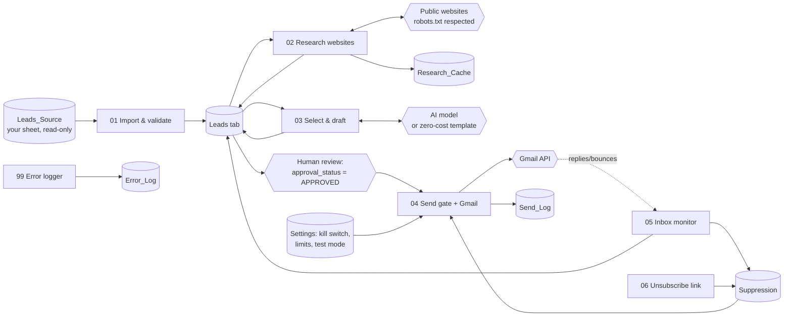

# FlowHQ Outreach

This system sends evidence-based, personalised B2B outreach for [FlowHQ](https://flowhq.in). It runs on n8n, Google Sheets and Gmail.

It reads a lead spreadsheet and reviews each business's public website. It records concrete, quoted evidence of improvement opportunities and maps that evidence to at most two FlowHQ services. It then drafts a short email and validates every claim against the evidence. Nothing is sent until a human approves the draft and live sending has been explicitly enabled.

> **Status:** built and tested offline and inside a real **n8n 2.41.6** instance, with Google Sheets, Gmail and the AI model **mocked**. The real Google, Gmail and AI integrations have **not** been exercised yet because no credentials were used. [docs/TESTING.md](docs/TESTING.md) lists exactly what is verified and what is not.
>
> **Shipped defaults:** `SENDING_ENABLED=false`, `TEST_MODE=true`, `REQUIRE_APPROVAL=true`. Live sending also needs a written approval record in the config.

## Architecture



Plain-text version:

```
Leads_Source --01--> Leads --02 research--> evidence + cache --03 select/draft/validate--> READY_FOR_APPROVAL
      --human approves--> 04 send gate (kill switch, test allowlist, limits, dedupe, suppression, compliance)
      --> Gmail API --> Send_Log;   inbox --05--> opt-outs/bounces/replies -> Suppression & lead status
```

Each lead moves forward through `outreach_status`, and every workflow selects leads by status. Re-running any workflow is therefore safe: completed work is skipped, and a lead is marked `SENDING` before the Gmail call, so it can never be sent twice.

## Repository layout

| Path | What it is |
|---|---|
| `workflows/*.json` | Importable n8n workflows (generated, with placeholder config). |
| `lib/` | Core logic: mapping, validation, research, evidence detectors, selection, validation, send gate, MIME, inbox. Pure JavaScript, unit-tested, bundled into the n8n Code nodes by the build. |
| `config/` | `settings.default.json` (switches, limits, sender), `service-catalogue.json` (what FlowHQ offers), `compliance.json` (per-country gates), `field-mapping.json` (column aliases). |
| `templates/FlowHQ-Outreach-Template.xlsx` | Spreadsheet with every tab and column. Upload it to Google Drive. |
| `scripts/` | `build-workflows.js`, `build-template.py`, `local-pipeline.js` (offline runner), `n8n-harness.js` (runs the workflows in a real n8n against mocks), fixture and mock servers. |
| `test/` | 49 unit, integration and end-to-end tests (`npm test`). |
| `data/synthetic/`, `fixtures/sites/` | Synthetic test leads and websites. Every domain is a reserved `.example` domain, so none of it can reach a real business. |
| `docs/` | Setup, workflows, spreadsheet, compliance, costs, testing, go-live checklist, sample drafts. |

## Quick start

1. Read **[docs/SETUP.md](docs/SETUP.md)**. It covers credentials, the spreadsheet, import and the preflight check.
2. Run the safe test procedure in **[docs/TESTING.md](docs/TESTING.md#safe-test-procedure-with-your-real-setup)**.
3. Go live only after completing **[docs/GO_LIVE_CHECKLIST.md](docs/GO_LIVE_CHECKLIST.md)**.

Other docs:
- [Workflow-by-workflow explanation](docs/WORKFLOWS.md)
- [Spreadsheet columns and connecting your real sheet](docs/SPREADSHEET.md)
- [Compliance notes for the US, UK, AU and NZ](docs/COMPLIANCE.md)
- [Operating costs](docs/COSTS.md)
- [Sample drafts](docs/SAMPLE_DRAFTS.md)

## Development

```bash
npm test                      # 49 tests (Node >= 20)
npm run build:defaults        # regenerate workflows/ from lib/ + config/ (placeholders)
npm run build                 # with config/settings.local.json -> out/workflows-local/ (git-ignored)
npm run build:template        # regenerate the .xlsx template (needs python3 + openpyxl)
N8N_BIN=... npm run harness   # run the workflows inside a real n8n (Node >= 24) against mocks
```

Edit logic in `lib/`, never directly inside the Code nodes, then rebuild. The workflows embed the exact code that the tests cover.
